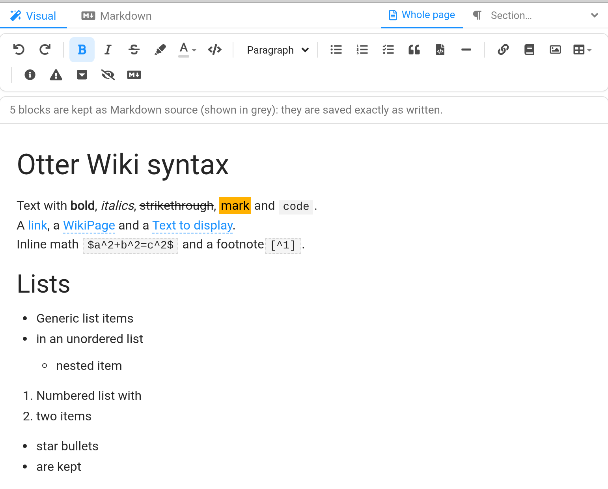
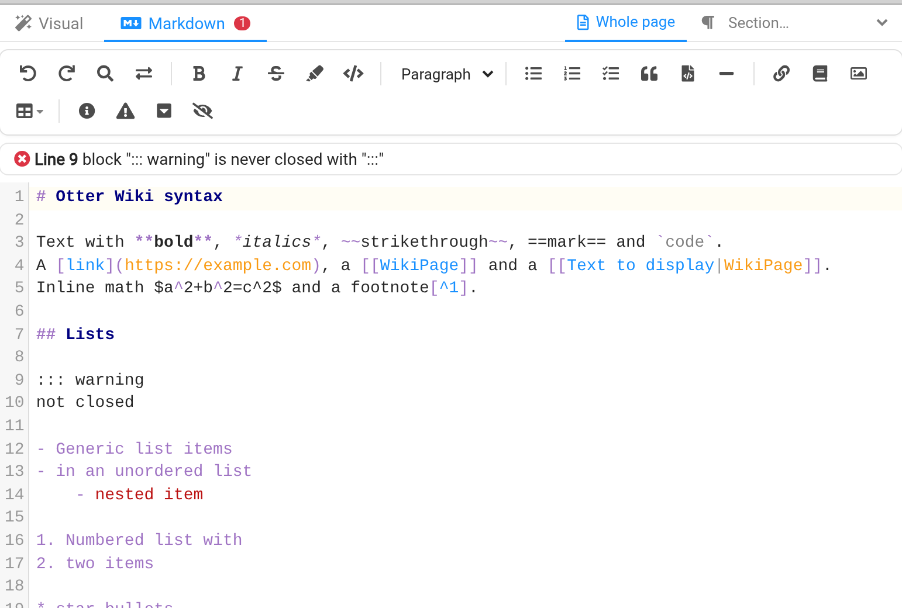
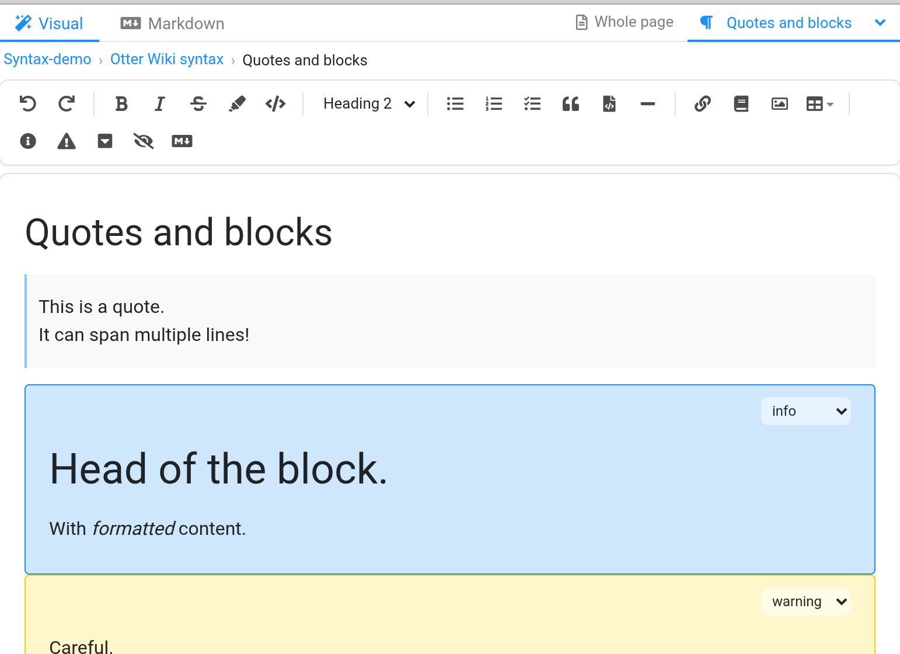

# otterwiki-wysiwyg

A visual (WYSIWYG) editor for [An Otter Wiki](https://otterwiki.com), as a plugin.
**Pages stay Markdown files** in the wiki's git repository.

The page editor gets two tabs, **Visual** and **Markdown**, and one toolbar
for both, in place of the wiki's own: in the Markdown tab its buttons write the
Markdown (`**bold**`, `::: info`, `> [!NOTE]`, `[[link]]`...). People who do not
want to learn Markdown edit the page as it will look; people who do keep the
Markdown editor. Both edit the same page, and you can switch at any time.



- **Lossless.** Blocks you do not edit are saved byte for byte as they were:
  opening a page in the visual editor and saving it changes nothing, and an
  edit shows in the git history as a change of that block only.
- **The wiki's own Markdown.** Coloured blocks (`::: info`), alerts
  (`> [!NOTE]`), folded blocks (`>|`), spoilers (`>!`), `==mark==`,
  `[[WikiLinks]]`, tables, checklists, code blocks, images are edited visually,
  and written back in the wiki's syntax.
- **Text colour.** A palette in the toolbar; written as
  `<span style="color: …">text</span>`, the coloured text the wiki shows.
- **Nothing is lost.** Syntax without a visual form (math, embeddings like
  `{{TOC}}`, footnotes, abbreviations, raw HTML…) and any block the editor
  could not write back exactly are kept as grey *Markdown* boxes, editable as
  source.
- **Everything else is the wiki's.** Drafts, live preview, save, "unsaved
  changes" and the commit message work as before: the visual editor writes into
  the wiki's Markdown editor, which stays in charge.
- **Markdown check.** The Markdown tab lists, line by line, what would break the
  page or the visual editor: an unclosed code block or `:::` block, an alert
  without a body, an unknown alert type, an unclosed `[[`, a table row with the
  wrong number of columns, a block the visual editor could only keep as
  source. Click a problem to jump to its line; the tab shows how many there are.
- **One section at a time** (option): *Whole page* / *Section…* next to the
  tabs, and a breadcrumb of the open section. Both tabs edit that section only
  (the Markdown one in an editor of its own); the rest of the page is kept as
  is, and headings added there are new sections. A pencil on each heading of a
  page opens its section in the visual tab.
- Paste or drop an image: it is uploaded as an attachment of the page.

Built on [Tiptap](https://tiptap.dev) 3 and its Markdown extension.

| The Markdown tab: same toolbar, Markdown check | One section at a time, with its breadcrumb |
|---|---|
|  |  |

## Install

An Otter Wiki installs the plugins it finds in `/plugins` (or
`/app-data/plugins`) when its container starts. Put this repository there:

```yaml
# docker-compose.yml of your wiki
services:
  otterwiki:
    image: redimp/otterwiki:2.26.0
    volumes:
      - ./app-data:/app-data
      - ./otterwiki-wysiwyg:/plugins/otterwiki-wysiwyg:ro
```

```sh
git clone https://github.com/quazardous/otterwiki-wysiwyg.git
docker compose up -d
```

Without Docker: `pip install git+https://github.com/quazardous/otterwiki-wysiwyg.git`
in the wiki's Python environment, then restart the wiki.

The built editor (`otterwiki_wysiwyg/static/`) is part of the repository, so
installing needs no Node.js.

Tested with An Otter Wiki 2.26.0.

## Use

Open a page, *Edit*: the editor opens on the **Visual** tab. The **Markdown**
tab is the wiki's own editor, with the Markdown check above it. Your browser
remembers the tab you used last.

The toolbar is the same in both tabs, above the editing area. In the visual tab
it formats the page; in the Markdown tab the same buttons write the Markdown
(`**bold**`, `## heading`, `- list`, `::: info`, `> [!NOTE]`, `>|` folded block,
`[[link]]`, a coloured `<span>`, a table...), and the wiki's search, replace and table tools are
there too.

## Options

In the wiki's `settings.cfg`, or as environment variables of its container:

| Option | Default | |
|---|---|---|
| `WYSIWYG_SECTION_EDIT` | `false` | *Whole page* and *Section…* (a list of the page's headings) next to the tabs: both tabs edit one section only, from its heading to the next heading of the same level or higher, with a breadcrumb (page › parent headings › section). Every change is written back into the whole page, so drafts, preview and save are unchanged; headings added there are new sections. A pencil on each heading of a page (on hover) opens its section in the visual tab. |

## How it works

- `otterwiki_wysiwyg/__init__.py`: the plugin. It serves the bundle and injects
  it into the editor page only (hooks `template_html_head_inject`,
  `template_html_body_inject`).
- `frontend/src/syntax.js`: Tiptap nodes for the wiki's Markdown dialect, each
  with its tokenizer and serializer. The grammars follow the wiki's renderer
  (`otterwiki/renderer_plugins.py`).
- `frontend/src/roundtrip.js`: the lossless round trip. The page is cut into
  top-level blocks with the editor's own lexer; each block remembers its exact
  source and the nodes it produced. On save, nodes that still match a block are
  written as that block's original text; only edited or new blocks go through
  the serializer. A block whose serialization would not read back the same is
  loaded as a source box.
- `frontend/src/index.js`: the integration with the editor page (tabs, toolbar,
  Markdown check panel, sections). Every change in the visual editor is written
  to the wiki's CodeMirror editor.
- `frontend/src/toolbar.js`: the toolbar of both tabs, in place of the wiki's
  (hidden in CSS); `frontend/src/md-actions.js`: what its buttons write in the
  Markdown tab.
- `frontend/src/lint.js`: the Markdown check.
- `frontend/src/section.js`: the Markdown editor of a section (CodeMirror 6,
  with a light Markdown mode, `markdown-mode.js`, and the wiki's colours,
  `section-theme.js`), in `section-editor.js`, loaded the first time a section
  is opened. It lives in a shadow root: two CodeMirror bundles on one page
  would replace each other's styles.
- `frontend/src/sections.js`: the section links of a page being read (a small
  script of its own: the editor is only loaded by the editor page).

## Develop

Requirements: Docker, Node.js 20+.

```sh
make install   # frontend dependencies
make test      # round-trip tests
make e2e       # end-to-end tests in Chrome, against the local wiki
make screenshots  # the README screenshots (docs/)
make check-pages DIR=<wiki repository>  # every page written back unchanged? (counts only)
make up        # build the bundle, start a wiki on http://localhost:8080 (no login)
make seed      # add demo pages with every syntax
make watch     # rebuild the bundle on change, then reload the page
make restart   # after a change of the Python side
make help      # everything else
```

The local wiki runs the plugin from this checkout (`PYTHONPATH` in
`docker-compose.yml`), with `WYSIWYG_SECTION_EDIT` on.

## Known limits

- Section numbers follow the page's top-level headings: a front matter
  `title`, shown as a heading by the wiki, shifts them.
- An edited block is normalized by the serializer (e.g. `*` bullets become
  `-`, `_emphasis_` becomes `*emphasis*`). Untouched blocks are not.
- Reference-style links (`[text][1]` with `[1]: url` elsewhere) are kept as
  text and source: edit them in the Markdown editor.
- No live preview next to the visual editor: it is already a preview.

## License

[MIT](LICENSE). Not affiliated with An Otter Wiki.

The bundles include [Tiptap](https://tiptap.dev), [ProseMirror](https://prosemirror.net),
[marked](https://marked.js.org) and [CodeMirror](https://codemirror.net), all MIT:
their licenses are in
[`otterwiki_wysiwyg/static/THIRD-PARTY-LICENSES.txt`](otterwiki_wysiwyg/static/THIRD-PARTY-LICENSES.txt).
