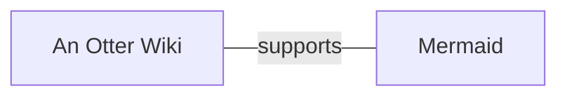

# Otter Wiki syntax

Text with **bold**, *italics*, ~~strikethrough~~, ==mark== and `code`.
A [link](https://example.com), a [[WikiPage]] and a [[Text to display|WikiPage]].
Inline math $a^2+b^2=c^2$ and a footnote[^1].

## Lists

- Generic list items
- in an unordered list
    - nested item

1. Numbered list with
2. two items

* star bullets
* are kept

- [ ] a task
- [x] a done task

## Quotes and blocks

> This is a quote.
> It can span multiple lines!

::: info
# Head of the block.
With _formatted_ content.
:::

::: warning
Careful.
:::

>! Spoiler blocks reveal their
>! content on click on the icon.

>| # Headline is used as summary
>| with the details folded.

> [!NOTE]
> Useful for highlighting special
> information.

> [!WARNING]
> Mind the gap.

## Tables

| Column 1 | Column 2 | Column 3 |
| -------- | :------: | -------: |
| John     | Doe      | Peach    |
| Mary     | Smith    | Banana   |

## Code

```python=
print("Hello Line Numbers!")
```



## Math

$$a^2+b^2=c^2$$

```math
a^2+b^2=c^2
```

## Misc

{{TOC}}

The HTML specification is maintained by the W3C.

*[HTML]: Hyper Text Markup Language
*[W3C]: World Wide Web Consortium

<details><summary>raw html</summary>kept as is</details>

---


[^1]: Footnotes can be a single line.
